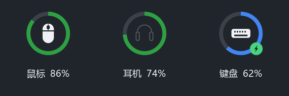

# BatteryTray 功能介绍

> Windows 托盘电量显示工具 —— 让鼠标、键盘和耳机的电量一眼可见，不再靠猜。


## 一句话简介

BatteryTray 常驻在 Windows 系统托盘，为每台在线设备显示一个**设备轮廓 + 环形电量**的小图标，读取**鼠标**和**蓝牙耳机**的剩余电量。不用装厂商驱动、不用开管理员权限、不占用任何可见窗口。

---

## 核心功能

### 1. 托盘图标：设备轮廓 + 电量环

每台在线设备在通知区域各占一个图标，图标是设备本身（鼠标 / 键盘 / 耳机），外圈是一圈电量进度环：

| 环的颜色 | 含义 |
|---------|------|
| 🟢 绿色 | 电量 ≥60% |
| 🟠 橙色 | 电量 20–59% |
| 🔴 红色 | 电量 <20% |
| 🔵 蓝色 | 充电中，右下角带绿色闪电徽标 |

环从 12 点方向开始顺时针填充。鼠标悬停会显示设备名和精确百分比；多台设备时每台一个图标，互不遮挡。关闭设置里的“托盘图标显示所有设备的电量”后，只保留电量最低的那一个图标。



### 2. 左键浮层：托盘图标 + 名字，竖着排

- 左键点击任一托盘图标，弹出**竖向设备列表**
- 每行：**和托盘相同的环形设备图标 + 设备名 + 精确百分比**
- 下方小字显示连接状态（蓝牙 / 2.4GHz / 充电中）
- **点击别处自动收起**，不打断你正在做的事
- 离线设备**不会**出现在列表里

### 3. 右键菜单：全部功能都在这

| 菜单项 | 作用 |
|--------|------|
| 查看电量 | 直接弹出浮层面板 |
| 打开主窗口 | 打开紧凑电量主界面 |
| 立即刷新 | 不等轮询间隔，马上读一次电量 |
| 设置 | 打开设置窗口 |
| 开机自启 | 勾选后开机自动启动 |
| 打开启动文件夹 | 一键定位到自启快捷方式所在目录 |
| 退出 | 关闭程序 |

### 4. 主窗口：紧凑电量行

- **深色主题**，每台设备一行
- 左侧是一枚**小电池图标**，电量百分比直接写在电池内部；黄色/红色/蓝色只改变填充颜色，不改变图标大小
- 右侧显示**设备名、连接方式、刷新率、DPI**
- 点击行尾的 **✎** 图标可**自定义设备名称**（例如把 `Razer Viper V3 Pro Wired` 改成「我的毒蝰 V3」）
- 离线设备在这里显示「未连接」和 `--`，不会误报 100%
- 右下角「设置」按钮直达设置窗口

### 5. 设置窗口：可调项

| 选项 | 说明 |
|------|------|
| 显示的设备类型 | 鼠标 / 耳机 / 游戏手柄 / 键盘，逐项勾选 |
| 低电量提醒阈值（%） | 范围 1–100，达到时弹系统通知 |
| 启用低电量通知 | 关闭后不再弹通知 |
| 轮询间隔（秒） | 范围 15–3600 |
| 托盘图标显示所有设备的电量 | 关闭则只画电量最低的那台 |

保存后**立即生效**，并写入配置文件。

### 6. 单实例运行

基于命名互斥量实现。重复点击图标、重复启动程序都**不会堆叠多个实例**，托盘永远只有一个图标。

### 7. 开机自启

通过**启动文件夹快捷方式**实现（不写注册表、不装服务、不需要管理员权限）。托盘右键「打开启动文件夹」可以一键定位。

---

## 支持的设备

### 已适配的品牌与型号一览

| 品牌 | 类型 | 型号 / 系列 | 协议来源 |
|------|------|------------|---------|
| **雷蛇 Razer** | 鼠标 | 毒蝰 V3 Pro 等，设备表共 **65 个型号** | OpenRazer 设备库 |
| **华硕 ROG** | 鼠标 | 月刃无线 AimPoint（Keris Wireless AimPoint） | g-helper |
| **华硕 ROG** | 键盘 | Falchion（幻灵）系列、Claymore II（棱剑 II）、Azoth / Azoth Extreme（魔剑 / 魔剑 Extreme）、Strix Scope II 96、Strix Flare II、TUF Gaming K3、TX 98 | g-helper / HaloBattery |
| **华硕 ROG** | 接收器 | Omni Receiver（Omni 接收器） | g-helper / HaloBattery |
| **罗技 Logitech** | 鼠标 / 键盘 | Unifying / Bolt 接收器下的全部无线设备 | Solaar（HID++ 2.0） |
| **ATK** | 鼠标 | A系列、eXceiver 无线鼠标 | Compx 帧 |
| **VXE** | 鼠标 / 键盘 | V75 Pro 键盘、V 系列鼠标 | Compx 帧 / 厂商状态通知 |
| **VGN** | 鼠标 | 铝翼、凤鸣等系列 | Compx 帧 |
| **Pulsar** | 鼠标 | XS-1 无线鼠标 | 65 字节 feature 帧 |
| **Scyrox** | 鼠标 | V6 / V6E 无线鼠标 | Compx 帧 |
| **达尔优 DAREU** | 鼠标 | 无线系列 | Compx 帧 |
| **G-Wolves** | 鼠标 | 无线系列 | Compx 帧 |
| **AULA** | 鼠标 | 无线系列 | AULA 20 字节帧 |
| **LEOBOG** | 鼠标 | 无线系列 | AULA 帧 |
| **狼蛛** | 鼠标 | 无线系列 | AULA / Compx 帧 |
| **凌豹** | 鼠标 | 无线系列 | AULA 帧 |
| **迈从 Incott** | 鼠标 | 无线系列 | AULA 帧 |
| **MCHOSE** | 鼠标 / 耳机 | G/M/K 系列鼠标、无线耳机 | 取反载荷帧 |
| **Keychron** | 键盘 | M5 / M6 / M7 无线键盘 | 厂商集合 `0xFFC1` |
| **Lamzu** | 鼠标 | OEM 无线鼠标 | 65 字节 feature 报告 |
| **Ninjutso / NINX** | 鼠标 | 无线鼠标 | Nordic 32 字节 feature 报告 |
| **Bloody** | 鼠标 / 键盘 | A4Tech Bloody 无线系列 | `80 FF 00` 命令帧 |
| **HyperX** | 耳机 | Cloud Alpha / Cloud III 无线耳机 | `21 FF 05` 输出报告 |
| **SteelSeries** | 耳机 | Arctis / Nova / GameBuds 系列 | `00 20` 等命令表 |
| **雷柏 Rapoo** | 鼠标 / 键盘 | 2.4G 无线系列 | 接收器主动推送 `07` |
| **Attack Shark** | 鼠标 | 无线系列 | 接收器主动推送 |
| **Lofree** | 键盘 | Hyzen（矮轴）2.4G 键盘 | `0xFF1C:0x92` 三段式事务 |
| **NZXT** | 鼠标 | Lift Elite 无线鼠标 | `0xFFCA:0x0001` 遥测帧 |
| **Endgame Gear** | 鼠标 | 无线系列 | 2.4G 接收器 |
| **VAXEE / ZYGEN** | 鼠标 | 无线系列 | 2.4G 接收器 |
| **Nordic nRF** | 鼠标 / 键盘 | 通用 2.4G 接收器 | Nordic 特征报告 |
| **HID 标准电池页** | 通用 | usage page `0x06` / usage `0x20` 的设备 | 标准 HID 电池页 |
| **蓝牙** | 耳机 / 手柄 / 键鼠 | 通过 HFP 上报电量的设备（Sony、WH-CH720N 等） | Windows 蓝牙 PnP 属性 |

> 键盘与手柄默认**不显示**，需要在设置窗口里手动勾选「键盘」「游戏手柄」。

### 能力边界

| 能力 | 范围 |
|------|------|
| 只读电量 | 上述除雷蛇、ROG 月刃外的全部设备 |
| 读电量 + 改 DPI / 回报率 / 按键 | 雷蛇毒蝰 V3 Pro、ROG 月刃无线 AimPoint |
| 设备型号库 | `batterytray/drivers/devices.py` 里维护 VID/PID → 友好名称 |

---

## 技术亮点

### 雷蛇鼠标：免驱动的 HID 直读

雷蛇设备的电量通过 **HID feature report** 查询，协议沿用 OpenRazer 的 `struct razer_report`。整包 **91 字节**，返回值 0..255 的原始刻度，换算百分比即 `raw * 100 / 255`。

**关键实现细节**：Windows 的 `mouclass` 驱动在鼠标使用期间会持有独占锁，用读写方式打开设备会得到 `ERROR_ACCESS_DENIED`。必须用 `desired_access = 0` 打开句柄才能发送 feature report —— 这是 [`damianyoko/viper-tray`](https://github.com/damianyoko/viper-tray) 和 [`nuxencs/razertray`](https://github.com/nuxencs/razertray) 都采用的绕过方式。

毒蝰 V3 Pro 的设备 ID：USB 有线 `PID 0x00C0`，无线接收器 `PID 0x00C1`，transaction id 为 `0x1F`。

### ROG 鼠标：原生 HID 协议

ROG 月刃无线 AimPoint 使用另一套 64 字节负载的 HID 报文，协议实现参考 [`seerge/g-helper`](https://github.com/seerge/g-helper)。`0x12` 读、`0x51` 写、`0x50` 配置/保存，每次写入后必须发 `0x50 0x03` 落盘。回包里会混入按键事件，读取时按 `report id + 命令族 + 子命令` 过滤。

设备 ID：有线 `0x1A66`、2.4G `0x1A68`、蓝牙 `0x1A6A`、Omni `0x1ACE`。控制接口在 `MI_00`，Omni 在 `MI_02&Col03`。本体回报率上限 1000 Hz，2000 Hz 以上属于其他接收器型号。

### 二十多个厂商协议：统一在一张协议表里驱动

`batterytray/drivers/vendor2.py` 把二十来种厂商协议统一成同一张表，每条记录声明 **VID、usage page、usage、报文字节数、读写长度、优先级**，运行时按优先级依次尝试，谁先答上就用谁：

```python
Protocol(name="Lofree 2.4G", vendor_ids=(0x388D,),
         usage_page=LOFREE_USAGE_PAGE, usage=LOFREE_USAGE,
         mode="output", length=LOFREE_FRAME, read_length=LOFREE_FRAME,
         priority=58),
```

三类报文形态：

| 形态 | 代表协议 | 做法 |
|------|---------|------|
| 一次性输出 + 等回复 | ASUS ROG 键盘、NZXT Lift Elite、Keychron | 发固定查询帧，按 feature report 读回并校验 |
| 三段式事务 | Lofree Hyzen | `START` → `命令` → `END`，中途任何一步没回应就放弃 |
| 接收器主动推送 | 雷柏、Attack Shark | 不发查询，直接监听接收器周期上报的状态包 |

只读不写：所有协议只发「读电量」命令，绝不写设备的 DPI、回报率或灯效，避免和厂商驱动打架。

### Lofree Hyzen：三段式事务

`0xFF1C:0x92` 集合上的 31 字节帧，事务必须按三步走：开始（`04 00 00 01`）→ 命令（`04 00 00 <cmd> 00 00 00 00`）→ 结束（`04 00 00 02`）。在线查询用 `0xAA`，电量查询用 `0x1A`，回复的第 8 字节是电量。任何一步没有回应都会直接放弃，避免把「键盘休眠」当成 0%。

### ASUS ROG 键盘：`12 01` 与 Falchion 的额外偏移

报告长度 65 字节，查询帧是 `12 01`。Windows 有时会在前面补一个 Report ID，所以解析时先看头两字节判断基准偏移：

```python
base = -1 if (data[0] == 0x12 and data[1] == 0x01) else 0
```

Falchion 一族多一个 0–10 的档位刻度，真正的百分比在**第 11 字节**，不能直接取第 6 字节。Omni 接收器要先用 `01 A0 00 00` 读配对列表，把键盘的通道号和名字取出来，键盘本身再走 `0xFF00` 的 Report ID `0x02`。

### 蓝牙耳机：未公开的 PnP 属性

Windows 蓝牙协议栈在收到耳机通过 HFP 上报的电量后，会把它写入一个未公开的设备属性：

```
DEVPKEY_Bluetooth_BatteryLevel
{104EA319-6EE2-4701-BD47-8DDBF425BBE5}, pid = 2
DEVPROP_TYPE_BYTE，值为 0..100
```

这个属性挂在设备的 **Hands-Free / 免提节点**上，不在设备主节点上。读取路径：`SetupDiGetClassDevsW` → `SetupDiEnumDeviceInfo` → `SetupDiGetDevicePropertyW`。

### 解决了「离线设备显示 100%」这个经典 bug

Windows 把电量写进设备节点后**不会清除**。耳机关机、超出范围之后，这个属性依然保留最后一次的读数 —— 表现就是耳机明明没连，却一直显示 100%。

BatteryTray 因此额外读取连接信号来判断设备是否真的可达：

| 来源 | 字段 | 含义 |
|------|------|------|
| PnP 属性 | `{83DA6326-97A6-4088-9453-A1923F573B29} 15` | `IsConnected`，蓝牙协议栈维护的连接标志 |
| 注册表 | `BTHPORT\Parameters\Devices\<地址>\LastSeen` | 协议栈最后一次听到该设备的时间 |

判定规则：

- 标志为**已连接** → 可达，直接显示电量
- 标志为**未连接**，但 `LastSeen` 在 **5 分钟内** → 设备刚刚还在，判定为可达
- 其余情况 → 判定为离线，界面显示「未连接」和 `--`，不显示电量条

> **踩过的坑**：最初用的是「电量上报时间戳」来判断可达性，结果断开的耳机照样显示 100%。原因是 **Windows 在设备断开的瞬间会再写一次电量属性**，把上报时间戳刷新到断开时刻（实测：注册表 `LastSeen` 是 `20:52:57`，而电量上报时间戳是 `20:53:01`，晚了 4 秒）。所以上报时间戳完全不能用来判断在线状态，只有协议栈的 `LastSeen` 才行。

### 设备类型的可靠判断

设备的**友好名称**往往说不清它是什么（`ROG KERIS WIRELESS AIMPOINT` 是鼠标，`Xbox Wireless Controller` 是手柄），所以分类以**蓝牙协议栈记录的 Class of Device** 为准：

| 来源 | 字段 | 判据 |
|------|------|------|
| HID 设备 | `LEAppearance` | 低 6 位是 HID 子类：`0x02` 鼠标、`0x01` 键盘、`0x03/0x04` 手柄 |
| 经典设备 | `COD` | 高 5 位大类 + 次 3 位小类：`0x04` 音频、`0x05` 外设 |

这些值存在注册表 `HKLM\SYSTEM\CurrentControlSet\Services\BTHPORT\Parameters\Devices\<地址>` 下。名称只作为兜底。

---

## 配置

配置文件：`%APPDATA%\BatteryTray\config.json`

| 字段 | 默认值 | 说明 |
|------|--------|------|
| `poll_interval` | 60 | 轮询间隔（秒），最小 15 |
| `enabled_kinds` | `null` | 要显示的设备类型；`null` 表示默认（鼠标+耳机），空数组表示全部关闭 |
| `include_other_peripherals` | false | 旧开关，与 `enabled_kinds` 保持同步 |
| `show_every_device` | true | 多设备时是否每个都画一根电量条 |
| `low_battery_threshold` | 20 | 低电量提醒阈值（%） |
| `notify_low_battery` | true | 是否弹出系统通知 |
| `devices` | `[]` | 设备名白名单，空表示自动检测 |
| `custom_names` | `{}` | 自定义设备名称，键是设备原始名，值是显示名 |

最新一次读数同时写到 `%APPDATA%\BatteryTray\status.txt`，方便排查。

---

## 已知限制

- 雷蛇无线设备必须保持接收器插着；鼠标休眠时读不到，此时保留上一次读数并显示离线
- 蓝牙耳机的电量由耳机主动上报，Windows 无法查询未上报的设备
- 蓝牙设备离线时不会显示电量（显示「未连接」）；重新开机后需要等耳机上报一次电量才会恢复
- 电量显示的是原始刻度换算值，实际可能有 ±2% 误差
- 雷蛇耳机（Kraken / BlackShark）使用独立的厂商协议，未纳入本版本

---

## 参考项目

- [openrazer/openrazer](https://github.com/openrazer/openrazer) —— 设备库与协议定义的事实标准
- [damianyoko/viper-tray](https://github.com/damianyoko/viper-tray) —— Rust 写的毒蝰 V3 Pro 托盘工具，本项目的 `desired_access=0` 绕过方案来自这里
- [nuxencs/razertray](https://github.com/nuxencs/razertray) —— 报告结构与 CRC 的实现参考，设备表也由此提取
- [Fan4Metal/mouse_tray](https://github.com/Fan4Metal/mouse_tray) —— 多厂商驱动的架构参考
- [fastfetch-cli/fastfetch](https://github.com/fastfetch-cli/fastfetch) —— 蓝牙电量属性读取的参考实现
- [yszyszysz233/2.4G-battery-viewer](https://github.com/yszyszysz233/2.4G-battery-viewer) —— Hands-Free 节点属性的关键说明，以及 ATK/VXE、Endgame、VAXEE、Nordic 等 2.4G 电量协议
- [HeyOkay/HaloBattery](https://github.com/HeyOkay/HaloBattery) —— 二十多种厂商协议的逐字节实现与验证记录
- [seerge/g-helper](https://github.com/seerge/g-helper) —— ROG 鼠标与键盘 HID 协议
- [pwr-Solaar/Solaar](https://github.com/pwr-Solaar/Solaar) —— 罗技 HID++ 2.0 协议来源
