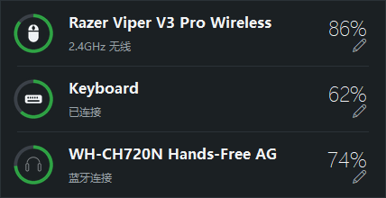
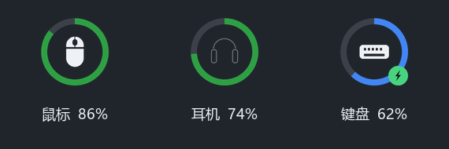
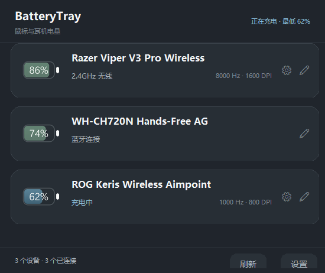

# BatteryTray

Windows 托盘电量显示工具 —— 在系统托盘里查看**鼠标、键盘**和**耳机**的电量。


## 📥 下载

| 版本 | 文件 | 说明 |
|------|------|------|
| **安装版（推荐）** | [`BatteryTray-Setup-1.3.3.exe`](https://github.com/HaonanBian/BatteryTray/releases/download/v1.3.3/BatteryTray-Setup-1.3.3.exe) | 带安装向导，装完自带开始菜单快捷方式和卸载程序 |
| **便携版** | [`BatteryTray-1.3.3-portable.zip`](https://github.com/HaonanBian/BatteryTray/releases/download/v1.3.3/BatteryTray-1.3.3-portable.zip) | 解压即用，免安装 |

> 免安装用户也可以直接下载 [`BatteryTray-1.3.3.exe`](https://github.com/HaonanBian/BatteryTray/releases/download/v1.3.3/BatteryTray-1.3.3.exe)（单文件版，双击即运行）。
>
> 想要**每个设备一根电量条**还是**只显示最危险的那个**，在设置里一键切换。
>
> 旧版本在 [Releases](https://github.com/HaonanBian/BatteryTray/releases) 里可以找到。

📖 完整功能介绍见 **[FEATURES.md](FEATURES.md)**。

## ✨ 功能一览

- 直接通过 USB HID 读取 **雷蛇毒蝰 V3 Pro** 和 **ROG 月刃无线 AimPoint（Keris Wireless AimPoint）** 的电量，**不需要装雷蛇 Synapse / 奥创中心**，不需要内核驱动，不需要管理员权限
- **直接在软件里改鼠标参数** —— DPI、回报率、DPI 挡位、按键映射，全部写进鼠标板载，关掉软件甚至换台电脑都还在
- **多品牌电量** —— 罗技 HID++（鼠标 + 键盘）、ATK/VXE/VGN、Endgame Gear、VAXEE/ZYGEN、Nordic nRF 2.4G 设备，以及 AULA、MCHOSE、Keychron、Pulsar、Lamzu、Ninjutso、Bloody、HyperX、SteelSeries、Lofree、NZXT、ASUS ROG 键盘等 20+ 个品牌
- 通过 Windows 蓝牙协议栈读取**蓝牙耳机**电量
- **每台在线设备一个托盘图标**：鼠标 / 键盘 / 耳机轮廓，外面一圈环形电量表；**圆环颜色和电量颜色一致**（绿色充足、橙色中等、红色低电、蓝色充电）
- **左键点击托盘图标**弹出竖排列表：每行是**托盘同款环形图标 + 设备名 + 精确百分比**，点别处自动收起
- **右键菜单**：查看电量 / 打开主窗口 / 立即刷新 / 设置 / 开机自启 / 打开启动文件夹 / 退出
- **主窗口**为紧凑电量行：**电池图标里直接显示百分比**，后面是设备名，支持**自定义设备名称**
- **单实例运行**（命名互斥量），重复点击托盘不会堆叠
- **低电量系统通知**，阈值可调（1–100%）
- **设备类型可筛选**：鼠标 / 耳机 / 游戏手柄 / 键盘
- **正确识别离线设备** —— 不再出现「耳机没连却显示 100%」的经典 bug
- **免安装**：纯用户态实现，不写注册表、不装服务、不需要管理员权限

## 🖥️ 界面

| 托盘浮层 | 主窗口 |
|---------|--------|
| 左键一点，竖排显示每台设备的环形图标、名称和百分比，点击别处自动收起 | 紧凑电量行，百分比直接写在电池图标里，可改名、可设置 |







## 🚀 快速开始

安装版一路下一步即可。免安装的话：

```
dist\BatteryTray.exe
```

把它放到一个**固定目录**（例如 `C:\Tools\BatteryTray\`），然后在托盘图标上右键勾选 **Start with Windows** 即可开机自启。

快捷方式放在：

```
%APPDATA%\Microsoft\Windows\Start Menu\Programs\Startup\BatteryTray.lnk
```

托盘右键菜单里的 **「打开启动文件夹」** 可以直接打开这个目录。开机自启失败时，多半是快捷方式指向的 exe 被移动或改名了 —— 重新勾选一次即可。

## 从源码运行

```bash
python -m venv .venv
.venv\Scripts\pip install -r requirements.txt
.venv\Scripts\python run.py
```

## 打包

```bash
.venv\Scripts\python -m PyInstaller --noconfirm --clean BatteryTray.spec
```

产物在 `dist\BatteryTray.exe`，约 15 MB。

## 工作原理

### 雷蛇鼠标：HID Feature Report

雷蛇设备的电量通过 HID feature report 查询，协议沿用 OpenRazer 的 `struct razer_report`：

| 偏移 | 字段 |
|------|------|
| 0 | 状态（`0x01` busy，`0x02` 成功） |
| 1 | transaction id |
| 5 | data size |
| 6 | command class |
| 7 | command id |
| 8–87 | 参数 |
| 88 | CRC（字节 2..87 的异或） |

电量查询命令为 `command class 0x07`（power）+ `command id 0x80`（battery level），返回值是 0..255 的原始刻度，换算成百分比即 `raw * 100 / 255`。充电状态用 `command id 0x84`。

线路上 feature report 前面多一个 HID report id，所以整包是 **91 字节**，上表所有偏移都要 +1。

**关键实现细节**：Windows 的 `mouclass` 驱动在鼠标使用期间会持有独占锁，用读写方式打开设备会得到 `ERROR_ACCESS_DENIED`。必须用 `desired_access = 0` 打开句柄才能发送 feature report —— 这是 `damianyoko/viper-tray` 和 `nuxencs/razertray` 都采用的绕过方式。

毒蝰 V3 Pro 的设备 ID：USB 有线 `PID 0x00C0`，无线接收器 `PID 0x00C1`，transaction id 为 `0x1F`。

### ROG 鼠标：HID 报文

ROG 月刃无线 AimPoint 走的是另一套 HID 协议。命令包是 64 字节负载，直连时前面再加 1 字节 report id（共 65 字节），Omni 接收器则是 64 字节含 report id：

| 偏移 | 字段 |
|------|------|
| 0 | report id（有线/2.4G `0x00`，Omni 接收器 `0x03`） |
| 1 | 命令族：`0x12` 读、`0x51` 写、`0x50` 配置/保存 |
| 2 | 子命令 |
| 3–64 | 参数，补零（Omni 到 63） |

几个容易踩的坑：

- 每次写入后必须再发 `0x50 0x03` 保存，否则鼠标只回显、断电就丢
- 命令回包可能混着按键/配置切换事件；必须校验 `report id + 命令族 + 子命令`，不能拿到第一个包就当答案
- 回报率编码为 `125→0, 250→1, 500→2, 1000→3`；月刃 AimPoint 本体最高 1000 Hz，2000 Hz 以上是别的接收器才支持，不能显示给用户
- DPI 按 `(dpi - 50) / 50` 编码，小端；读取时每档 4 字节（X/Y 各 2 字节）
- 按键是「源按键码 → 目标动作码」两个小端 16 位值，默认动作码等于源按键码

设备 ID：有线 `0x1A66`、2.4G `0x1A68`、蓝牙 `0x1A6A`、Omni 接收器 `0x1ACE`。控制接口在 `MI_00`；Omni 接收器在 `MI_02&Col03`。

### 蓝牙耳机：未公开的 PnP 属性

Windows 蓝牙协议栈在收到耳机通过 HFP 上报的电量后，会把它写入一个未公开的设备属性：

```
DEVPKEY_Bluetooth_BatteryLevel
{104EA319-6EE2-4701-BD47-8DDBF425BBE5}, pid = 2
DEVPROP_TYPE_BYTE，值为 0..100
```

**注意**：这个属性挂在设备的 **Hands-Free / 免提节点**上，不在设备主节点上。属性由驱动在收到上报时写入，耳机没连接或不上报电量时该属性不存在。

读取路径：`SetupDiGetClassDevsW` → `SetupDiEnumDeviceInfo` → `SetupDiGetDevicePropertyW`。

#### 离线设备的假电量（已修复）

Windows 把电量写进设备节点后**不会清除**。耳机关机、超出范围之后，这个属性依然保留最后一次的读数，程序每轮轮询都会读到它 —— 表现就是耳机明明没连，却一直显示 100%。

驱动因此额外读取连接信号来判断设备是否真的可达：

| 来源 | 字段 | 含义 |
|------|------|------|
| PnP 属性 | `{83DA6326-97A6-4088-9453-A1923F573B29} 15` | `IsConnected`，蓝牙协议栈维护的连接标志 |
| 注册表 | `BTHPORT\Parameters\Devices\<地址>\LastSeen` | 协议栈最后一次听到该设备的时间 |

判定规则：

- 标志为**已连接** → 可达，直接显示电量
- 标志为**未连接**，但 `LastSeen` 在 **5 分钟内** → 设备刚刚还在，判定为可达
- 其余情况 → 判定为离线，界面显示「未连接」和 `--`，不显示电量条

> **踩过的坑**：最初用的是「电量上报时间戳」来判断可达性，结果断开的耳机照样显示 100%。原因是 **Windows 在设备断开的瞬间会再写一次电量属性**，把上报时间戳刷新到断开时刻（实测：注册表 `LastSeen` 是 `20:52:57`，而电量上报时间戳是 `20:53:01`，晚了 4 秒）。所以上报时间戳完全不能用来判断在线状态，只有协议栈的 `LastSeen` 才行。

注意属性存储的类型标记和 SDK 头文件里的 `DEVPROP_TYPE_*` 不一致：布尔是 `0x11`、字符串是 `0x12`，读错类型会拿到原始 blob 而不是值。

#### 未连接设备的显示位置

离线设备只在**主窗口**出现，托盘弹出面板、托盘图标和悬停提示里都看不到它们。这样托盘保持清爽，只有真正能读���电量的设备才占位置。

| 位置 | 显示内容 |
|------|---------|
| 托盘弹出面板 | 仅已连接设备 |
| 托盘图标 | 仅已连接设备（每台设备一个） |
| 托盘悬停提示 | 仅已连接设备 |
| 主窗口 | 全部设备，离线的显示「未连接」 |

## 支持的设备

| 类型 | 说明 |
|------|------|
| 雷蛇无线鼠标 | 设备表共 65 个型号，transaction id 取自 OpenRazer 设备库 |
| ROG 月刃无线 AimPoint | 有线、2.4G 接收器、Omni 接收器和蓝牙连接；USB/2.4G 下可读写电量与参数 |
| 罗技无线鼠标 / 键盘 | HID++ 2.0，支持 Unifying/Bolt 接收器下多设备；只读电量 |
| ATK / VXE / VGN 无线鼠标 | 两种 Nordic 方案，只读电量 |
| VXE V75 Pro 无线键盘 | 从厂商状态通知读取电量，只读 |
| Endgame Gear / VAXEE / ZYGEN | 2.4G 接收器，只读电量 |
| Nordic nRF 方案无线设备 | 通用 2.4G 接收器，只读电量 |
| AULA / LEOBOG / 狼蛛 / 凌豹 | 20 字节帧协议，键盘和鼠标都支持，只读电量 |
| MCHOSE 无线鼠标 / 耳机 | 厂商控制集合，载荷逐位取反，只读电量 |
| Keychron 无线鼠标 / 键盘 | 厂商集合 `0xFFC1`，只读电量 |
| Pulsar 无线鼠标 | XS-1 的 65 字节 feature 帧，只读电量 |
| Attack Shark / 雷柏 | 接收器主动推送状态包，只读电量 |
| Lamzu / Ninjutso / Bloody | 厂商 feature 报告，只读电量 |
| HyperX 无线耳机 | 20 字节 `21 FF 05` 帧，只读电量 |
| SteelSeries 耳机 | Arctis / Nova / GameBuds 家族，只读电量 |
| Lofree Hyzen 键盘 | 2.4G 接收器上的三段式事务，只读电量 |
| NZXT Lift Elite 无线鼠标 | 2.4G 接收器与 USB 线，两种连接同一个图标，只读电量 |
| ASUS ROG 键盘 | Falchion / Azoth / Strix Scope / Claymore II 等家族，只读电量 |
| 蓝牙耳机 | 通过 HFP 上报电量的设备（Sony、WH-CH720N 等） |
| 蓝牙手柄 / 键鼠 | 可在**设置窗口**里勾选开启 |

默认只显示鼠标和耳机，手柄和键盘要在设置里打开。新增品牌目前只读取电量；DPI、回报率和改键仍只对雷蛇和 ROG 月刃开放。

完整的品牌与协议清单见 **[FEATURES.md](FEATURES.md)** 的「支持的品牌与协议」一节。

### 罗技 HID++ 2.0

罗技无线设备通过厂商 HID 接口上的 HID++ 2.0 功能表查询电量。程序会先找 `0x1000`（电量状态），再找 `0x1004`（统一电量），最后用 `0x1001`（电压）按锂电曲线估算百分比。接收器上的每台设备用 1–6 号设备索引区分，名字从 `0x0005` 读取。

### 其他 2.4G 品牌

ATK/VXE/VGN、Endgame Gear、VAXEE/ZYGEN 和 Nordic nRF 方案的协议定义集中在 `batterytray/drivers/hidvendor.py`，按「VID + usage page」精确匹配，不会误开其他厂商的接口。只发读电量命令，不写任何设置。

VXE V75 Pro 键盘例外：它使用 `320F:5088` 的 `0xFF1C` 厂商集合，请求报文是 64 字节的 `04 .. .. 1A 06`；回复里第 8 字节是电量、第 9 字节是充电状态。键盘休眠时会短暂不响应，按一下键盘再刷新即可。

### 二十多个厂商协议

`batterytray/drivers/vendor2.py` 收录了另外二十来种厂商协议的只读实现，同样只发读电量命令：

| 协议族 | 覆盖的品牌 | 报文特征 |
|--------|-----------|---------|
| Compx 17 字节 | ATK / VXE / VGN / Pulsar / Scyrox / 达尔优 / G-Wolves / Zaopin | `08 04` 开头，17 字节求和等于 `0x55` |
| AULA 20 字节 | AULA / LEOBOG / 狼蛛 / 凌豹 / 迈从 / Incott | `13` 开头，末字节是前面字节的低位和 |
| Keychron | Keychron M5 / M6 / M7 | 厂商页 `0xFFC1`，`B3 06` 查询，第 20 字节是电量 |
| Pulsar XS-1 | Pulsar | 65 字节 feature 帧，双字节校验和 |
| MCHOSE | MCHOSE 鼠标 / 耳机 | 载荷逐位取反，`0x06` 设备信息命令 |
| Lamzu | Lamzu | 65 字节 feature 报告 |
| Ninjutso | Ninjutso / NINX | 32 字节 Nordic feature 报告 |
| Bloody | A4Tech Bloody | `80 FF 00` 命令，回复 `06 56` |
| HyperX | Cloud Alpha / III 无线耳机 | `21 FF 05` 输出报告 |
| SteelSeries | Arctis / Nova / GameBuds | `00 20`（Nova）与各家命令表 |
| Rapoo | 雷柏 | 接收器主动推送 `07` 状态包 |
| Attack Shark | Attack Shark | 接收器主动推送，电量按 10% 步进 |
| Lofree | Lofree Hyzen 键盘 | `0xFF1C:0x92` 上的三段式事务 |
| NZXT | NZXT Lift Elite 无线鼠标 | `0xFFCA:0x0001`，`4E` 开头的 64 字节帧 |
| ASUS ROG | Falchion / Azoth / Strix Scope / Claymore II 等 | `12 01` 电量查询，第 6 字节是电量 |
| HID 标准电池页 | 通用 | usage page `0x06` / usage `0x20` 兜底 |

协议的具体报文格式和来源项目都写在 `vendor2.py` 里每个协议块的注释中，可以对着源码核对。

### 设备类型是怎么判断的

设备的**友好名称**往往说不清它是什么（`ROG KERIS WIRELESS AIMPOINT` 是鼠标，`Xbox Wireless Controller` 是手柄），所以分类以**蓝牙协议栈记录的 Class of Device** 为准：

| 来源 | 字段 | 判据 |
|------|------|------|
| HID 设备 | `LEAppearance` | 低 6 位是 HID 子类：`0x02` 鼠标、`0x01` 键盘、`0x03/0x04` 手柄 |
| 经典设备 | `COD` | 高 5 位大类 + 次 3 位小类：`0x04` 音频、`0x05` 外设 |

这些值存在注册表 `HKLM\SYSTEM\CurrentControlSet\Services\BTHPORT\Parameters\Devices\<地址>` 下。名称只作为兜底。

## 设置窗口

在**主窗口**右下角点「设置」，或**右键托盘图标**选「设置」，可以改：

| 选项 | 说明 |
|------|------|
| 显示的设备类型 | 鼠标 / 耳机 / 游戏手柄 / 键盘，逐项勾选 |
| 低电量提醒阈值（%） | 电量低于或等于该值时弹通知，范围 1–100 |
| 启用低电量通知 | 关闭后不再弹系统通知 |
| 轮询间隔（秒） | 范围 15–3600 |
| 托盘图标显示所有设备的电量 | 关闭则只画电量最低的那台 |

保存后立即生效并写入配置文件。

## 诊断

换了台电脑之后什么都读不到的时候，用**诊断**按钮把情况报告出来。

在**主窗口**右下角或**设置窗口**左下角点「诊断」，会打开一个窗口，里面写着：

- 每个驱动分别读到了什么设备
- HID 子系统能不能访问，接口有多少
- 蓝牙无线电回答了什么，设备节点上的时间戳是多少
- 程序最后到底显示了哪些设备
- 哪个驱动失败了，失败的原因是什么

报告可以**复制到剪贴板**、**保存为文件**，或者点「打开问题反馈」直接在 GitHub 上开一个
issue（内容已经填好了，粘贴给我就行）。

## 鼠标设置

在**主窗口**的鼠标卡片上点右侧的 **⚙ 齿轮**，打开鼠标设置窗口。

| 项目 | 说明 |
|------|------|
| **DPI** | 100–35000，另有 400/800/1600/3200/6400/12800/25600 快捷按钮 |
| **回报率** | 125 / 250 / 500 / 1000 / 2000 / 4000 / 8000 Hz，只显示硬件支持的值 |
| **DPI 挡位** | 最多 5 档，可选鼠标上的 DPI 键默认停在哪一档 |
| **按键映射** | 每个按键一个下拉菜单，可选**默认值**、无操作、其它鼠标按键、DPI 切换、配置文件切换、双击、连发、滚轮模式 |

所有改动都会**同时写入活动配置和鼠标板载**，所以拔插、重启、换电脑都还在。每次写入后都会**回读校验**，不一致会直接报错而不是假装成功。

### 按键恢复默认

鼠标没有「重置键位」命令，出厂默认是按 **函数 id 1 + 按键 id** 写进去的 —— 固件看到这个组合就知道「用这个键自己的原生行为」。

- **单个恢复**：在按键的下拉菜单里选**默认值**
- **全部恢复**：点按键列表下面的**全部恢复默认**

> **和 Synapse 的关系**：Synapse 里的「Default」选项也是这个写法，两边效果一致，可以互相覆盖。

> **回报率上限取决于连接方式**：有线最高 1000 Hz，8000 Hz 必须用随鼠标附带的 **HyperPolling 接收器**。软件会自动识别并只显示支持的值。
>
> **无线鼠标休眠**：鼠标几秒不动就会休眠，所有命令返回超时。这是鼠标的正常行为 —— 移动一下鼠标再点「应用」即可。

## 配置

配置文件：`%APPDATA%\BatteryTray\config.json`

| 字段 | 默认值 | 说明 |
|------|--------|------|
| `poll_interval` | 60 | 轮询间隔（秒），最小 15 |
| `enabled_kinds` | `null` | 要显示的设备类型；`null` 表示默认（鼠标+耳机），空数组表示全部关闭 |
| `include_other_peripherals` | false | 旧开关，与 `enabled_kinds` 保持同步 |
| `show_every_device` | true | 多设备时是否每个都画一根电量条 |
| `low_battery_threshold` | 20 | 低电量提醒阈值（%） |
| `notify_low_battery` | true | 是否弹出系统通知 |
| `devices` | `[]` | 设备名白名单，空表示自动检测 |
| `custom_names` | `{}` | 自定义设备名称，键是设备原始名，值是显示名 |

最新一次读数同时写到 `%APPDATA%\BatteryTray\status.txt`，方便排查。

## 自定义设备名称

在**主窗口**里点击设备卡片右侧的 ✎ 图标即可改名（回车保存，Esc 取消）；在**托盘浮层**里右键设备那一行，选择「重命名设备」会弹出对话框。

名称保存在 `custom_names` 里，重启后依然生效。要恢复默认名称，在改名框里清空内容即可。

```json
{
  "custom_names": {
    "Razer Viper V3 Pro Wired": "我的毒蝰 V3",
    "WH-CH720N Hands-Free AG": "降噪耳机"
  }
}
```

## 项目结构

```
batterytray/
├── app.py            # 托盘主程序、菜单、轮询循环
├── icon.py           # 托盘环形电量图标（设备轮廓 + 外圈进度）
├── window.py         # 主窗口（标题、列表、滚动）
├── card.py           # 紧凑电量行（电池内百分比、名称、状态）
├── art.py            # 玻璃电池与线框图标的 Pillow 绘制
├── quickpanel.py     # 托盘竖向电量列表（含全局鼠标钩子自动收起）
├── renamedialog.py   # 重命名对话框
├── settingsdialog.py # 设置窗口（设备类型、阈值、轮询间隔）
├── mousesettingsdialog.py # 鼠标设置窗口（DPI、回报率、挡位、改键）
├── diagnostics.py    # 诊断报告（每个驱动读到了什么）
├── diagnosticdialog.py # 诊断窗口（复制 / 保存 / 反馈）
├── widgets.py        # 深色主题的画布控件与配色
├── dpi.py            # Per-Monitor DPI 感知与缩放
├── config.py         # 配置读写
├── autostart.py      # 开机自启（启动文件夹快捷方式）
├── singleton.py      # 单实例互斥量
└── drivers/
    ├── razer.py      # 雷蛇 HID feature report（读电量）
    ├── mouseconfig.py # 雷蛇鼠标参数（DPI、回报率、挡位、按键映射）
    ├── asusmouse.py  # ROG 鼠标 HID 协议（电量、DPI、回报率、按键）
    ├── mouseadapter.py # 把不同厂商驱动包成同一套接口
    ├── logitech.py   # 罗技 HID++ 2.0 电量（鼠标 / 键盘）
    ├── hidvendor.py  # ATK/VXE、Endgame、VAXEE、Nordic 电量协议
    ├── vendor2.py    # 另外二十来种厂商协议（只读电量）
    ├── devices.py    # 型号名称库（VID/PID → 友好名称）
    └── bluetooth.py  # 蓝牙 PnP 电量属性
```

## 测试

```bash
.venv\Scripts\python -m pytest verify_all.py -q
```

180+ 个用例，覆盖协议编解码、CRC、图标渲染、配置读写、设备筛选与去重、Class of Device 分类、离线设备的电量屏蔽、离线设备的显示位置、设置窗口、重命名、单实例、开机自启和轮询循环。其中几个用例会直接读取你机器上真实连接的设备。

## 已知限制

- 雷蛇无线设备必须保持接收器插着；鼠标休眠时读不到，此时保留上一次读数并显示离线
- 蓝牙耳机的电量由耳机主动上报，Windows 无法查询未上报的设备
- 蓝牙设备离线时不会显示电量（显示「未连接」）；重新开机后需要等耳机上报一次电量才会恢复
- 电量显示的是原始刻度换算值，实际可能有 ±2% 误差
- 雷蛇耳机（Kraken / BlackShark）使用独立的厂商协议，未纳入本版本
- ROG 鼠标的参数设置只在 USB 有线或 2.4G 接收器下有效；蓝牙模式使用 BLE HID，Windows 不暴露厂商控制接口
- ROG 月刃 AimPoint 本体最高 1000 Hz；2000 Hz 以上只属于其他带 booster 接收器的型号
- 回报率上限取决于连接方式：有线 1000 Hz，2000 Hz 以上需要 HyperPolling 接收器

## 参考项目

- [openrazer/openrazer](https://github.com/openrazer/openrazer) —— 设备库与协议定义的事实标准，回报率上限也以它为准
- [damianyoko/viper-tray](https://github.com/damianyoko/viper-tray) —— Rust 写的毒蝰 V3 Pro 托盘工具，本项目的 `desired_access=0` 绕过方案来自这里
- [nuxencs/razertray](https://github.com/nuxencs/razertray) —— 报告结构与 CRC 的实现参考，设备表也由此提取
- [Fan4Metal/mouse_tray](https://github.com/Fan4Metal/mouse_tray) —— 多厂商驱动的架构参考
- [fastfetch-cli/fastfetch](https://github.com/fastfetch-cli/fastfetch) —— 蓝牙电量属性读取的参考实现
- [yszyszysz233/2.4G-battery-viewer](https://github.com/yszyszysz233/2.4G-battery-viewer) —— Hands-Free 节点属性的关键说明
- [1972863663/Viper-Control-Lite](https://github.com/1972863663/Viper-Control-Lite) —— MIT 协议的毒蝰 V3 Pro 参数工具，DPI 与回报率命令的参考实现
- [MatthewSaintBull/freenapse](https://github.com/MatthewSaintBull/freenapse) —— 专门针对毒蝰 V3 Pro 的开源工具，鼠标休眠问题的踩坑记录很有价值
- [seerge/g-helper](https://github.com/seerge/g-helper) —— ROG 鼠标与键盘 HID 协议的主要参考，覆盖 30 多款华硕设备，已在真机验证
- [HeyOkay/HaloBattery](https://github.com/HeyOkay/HaloBattery) —— 二十多种厂商协议的实现与逐字节的验证记录，AULA / MCHOSE / Lofree / NZXT / ASUS 等协议的来源
- [435311382/Volt](https://github.com/435311382/Volt) —— Compx 帧族与型号表
- [fisher44123/volt-battery-monitor](https://github.com/fisher44123/volt-battery-monitor) —— Compx 与狼蛛帧格式
- [mammadow/keychron-battery-tray](https://github.com/mammadow/keychron-battery-tray) —— Keychron 厂商集合协议
- [incconutwo/mouse-battery-tray](https://github.com/incconutwo/mouse-battery-tray) —— WLmouse 与 Pulsar 帧
- [ryanlewis/mousebatt](https://github.com/ryanlewis/mousebatt) —— Pulsar XS-1 帧与校验和
- [LORQAQ/mchose-tray](https://github.com/LORQAQ/mchose-tray) —— MCHOSE 控制集合与取反载荷
- [VoltWalt/scyrox-v6-kde-battery](https://github.com/VoltWalt/scyrox-v6-kde-battery) —— Compx 帧与校验和
- [pwr-Solaar/Solaar](https://github.com/pwr-Solaar/Solaar) —— 罗技 HID++ 2.0 电量、充电状态和设备名称的协议来源
- [yszyszysz233/2.4G-battery-viewer](https://github.com/yszyszysz233/2.4G-battery-viewer) —— ATK/VXE、Endgame、VAXEE、Nordic 等 2.4G 电量协议
- [CalcProgrammer1/OpenRGB](https://gitlab.com/CalcProgrammer1/OpenRGB/-/merge_requests/2316) —— 月刃 AimPoint 的 VID/PID 与灯效命令参考
- [kyokenn/hid-asus-mouse](https://github.com/kyokenn/hid-asus-mouse) —— Linux 下的华硕鼠标按键驱动，用于交叉验证按键码
- [uncoil 协议笔记](https://uncoil.justinthevoid.com/docs/protocol/) —— 最完整的 Razer 命令目录，含按键映射与 DPI 挡位；按键的 `fnIdEnum` 和「恢复默认 = 函数 id 1 + 按键 id」这个写法都出自这里
- [emilkowalski/skills](https://github.com/emilkowalski/skills) —— 界面与动效的设计规范，`apple-design` 一节讲了苹果界面的材质分层
- [nya-owo/cloudy](https://github.com/nya-owo/cloudy) —— 液态玻璃着色器的参考实现；本项目最终没有采用，电池图标改用了简洁的平面样式
